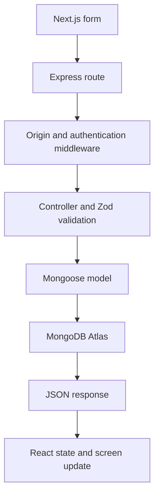

# 1. Understand the application

## Which technology does what?

| Technology | Job in this application |
| --- | --- |
| JavaScript | Language executed by browsers and Node.js |
| TypeScript | Adds static types; stripped/compiled before JavaScript executes |
| Node.js | Runtime executing the Express API and Next development/build tooling |
| Express | Defines API endpoints and middleware |
| Next.js | React framework serving the user interface |
| MongoDB | Document database holding users, tasks, and sessions |
| MongoDB Atlas | Hosted MongoDB service; your database runs in the cloud |
| Mongoose | Node library for schemas, validation, and MongoDB queries |

Next.js can provide its own backend using Route Handlers. Here Express is separate because the learning goal includes Node/Express. There are no duplicate task APIs in Next.js. The browser never connects directly to Atlas.

## Follow one Add task request

1. Open `client/src/components/TaskForm.tsx`. The submit handler prevents a normal page reload with `event.preventDefault()`.
2. `FormData` reads fields. We convert the comma-separated tags to an array and the date to an ISO string.
3. `api('/tasks', { method: 'POST', body: JSON.stringify(body) })` sends JSON. The wrapper sets Content-Type and includes the session cookie.
4. In `server/src/app.ts`, Origin is checked, JSON is parsed, and cookies are parsed. `/api/tasks` routes go to `taskRoutes.ts`.
5. `requireAuth` verifies the JWT signature/expiry, finds its active session, loads the user, and attaches `req.auth`.
6. The route `router.route('/').get(list).post(create)` chooses `create` because the HTTP method is POST.
7. `taskSchema.parse(req.body)` rejects invalid or unknown fields.
8. `Task.create({ ...data, owner: req.auth!.id })` inserts a task. The server determines the owner from authentication, not a user-supplied owner field.
9. MongoDB returns the new document, including `_id`. Express responds with HTTP 201 and `{ task }`.
10. The UI resets the form and refetches tasks and statistics.

## Models and relationships

**User**: name, unique email, passwordHash, role, timestamps.

**Task**: title, description, completed, priority, dueDate, tags, owner, timestamps.

**Session**: random string ID, user reference, expiresAt.

One user has many tasks and can have multiple sessions on different browsers. `owner` is an ObjectId reference, similar in purpose to a SQL foreign key, but MongoDB does not automatically enforce referential integrity or cascading deletes. The admin listing uses `populate` to display owner details.

`timestamps: true` adds `createdAt` and `updatedAt`. `completed` defaults to false. `dueDate: null` means no deadline. Schemas define acceptable document shape; request schemas additionally define exactly what each endpoint accepts.

## Route parameters, query parameters, body

For `PATCH /api/tasks/507f1f77bcf86cd799439011` with `{ "completed": true }`:

- `req.params.id` identifies the resource.
- `req.body.completed` contains the requested change.
- For `GET /api/tasks?completed=true&page=2`, `req.query` contains filters and pagination.
- `req.auth.id` comes from verified authentication.

Query values are strings. `Boolean('false')` is **true**, so the code explicitly parses the strings `'true'` and `'false'`. JSON bodies use real booleans, so `"completed":"true"` is rejected.

## Middleware and errors

Middleware executes in registration order. Helmet and CORS run before routes; authentication runs before task controllers; the error handler comes last. Express 5 forwards rejected async route promises to the error handler. Validation errors become 400, missing authentication 401, insufficient role 403, inaccessible/missing tasks 404, duplicate email 409, and unexpected failures 500.

Returning 404 for another person's task avoids confirming that the resource exists. `res.status(204).send()` has no JSON body, so the frontend helper handles it before attempting `response.json()`.

## Why separate folders?

Routes answer **which function runs?** Controllers answer **what should this request do?** Models answer **how is the data structured and queried?** Middleware answers **may the request proceed?** Utilities hold reusable filter construction. This division makes it easier to find, explain, and test one behavior.
